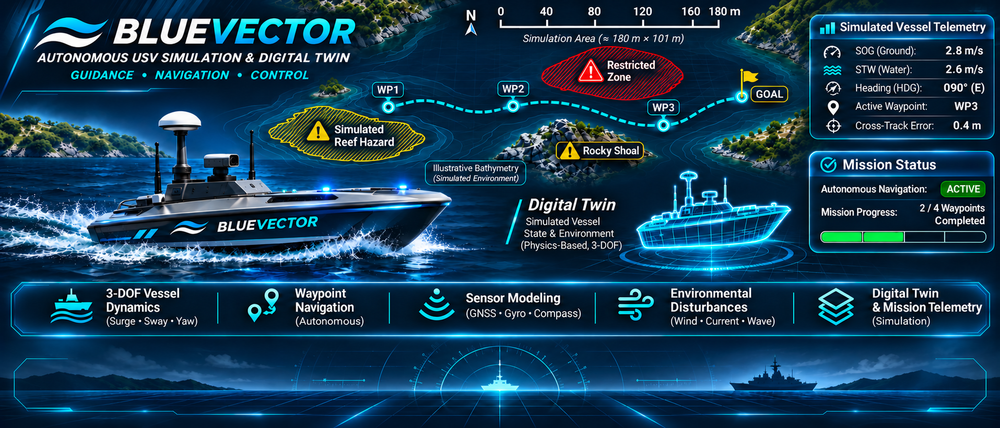

<div align="center">



# BLUEVECTOR

### Autonomous USV Simulation & Digital Twin

**Guidance · Navigation · Control**

A physics-based autonomous maritime simulation platform combining marine vessel dynamics, autonomous navigation, environmental disturbances, and real-time mission telemetry within an interactive Streamlit application.

</div>

---

## Overview

BLUEVECTOR is an interactive Uncrewed Surface Vehicle (USV) simulation and digital twin designed to explore maritime guidance, navigation, control, and autonomous mission performance.

The application models a small twin-thruster USV operating in a simulated maritime environment, incorporating vessel dynamics, sensor modeling, environmental forces, waypoint navigation, and degraded operating conditions.

Built using Python, Streamlit, and JavaScript, BLUEVECTOR combines physics-based simulation with an interactive digital command interface accessible through desktop and mobile browsers.

The project emphasizes autonomous systems engineering, mathematical modeling, control-system behavior, and mission-level performance analysis.

## Core Capabilities

### 1. Marine Vessel Dynamics

BLUEVECTOR implements a reduced-order three-degree-of-freedom (3-DOF) marine dynamics model representing:

- Surge: longitudinal vessel motion
- Sway: lateral vessel motion
- Yaw: rotational motion about the vertical axis
- Differential-thrust propulsion
- Hydrodynamic damping
- Coupled vessel motion
- Current-induced displacement
- Simplified wind and wave disturbances

The simulation uses a fixed numerical integration timestep to support consistent physical behavior across rendering frame rates.

### 2. Autonomous Guidance and Control

The application provides three primary operating modes:

**Manual Control**
- Interactive joystick and D-pad
- Keyboard-based piloting
- Differential propulsion commands
- Forward and reverse thrust

**Heading Hold**
- Closed-loop heading stabilization
- Adjustable commanded heading
- Automatic differential-thrust corrections
- Disturbance compensation

**Autonomous Waypoint Navigation**
- Four-waypoint demonstration mission
- User-configurable waypoint routes
- Line-of-sight guidance
- Heading and speed control
- Cross-track error monitoring
- Simplified obstacle avoidance and route detours

### 3. Navigation and Sensor Modeling

BLUEVECTOR incorporates simplified models of maritime navigation sensors and state estimation.

Implemented capabilities include:

- GNSS position measurements with configurable noise
- Gyroscope-based heading propagation
- Magnetic compass corrections
- Dead-reckoning navigation
- Position-estimation uncertainty
- Simulated GNSS interruptions
- Command-and-control (C2) link failures

These models allow users to examine how navigation uncertainty and system failures affect autonomous vessel behavior.

The current navigation model is illustrative and does not implement a fully calibrated inertial navigation system or extended Kalman filter.

### 4. Environmental Simulation

The maritime environment includes configurable disturbances and navigation hazards.

**Environmental parameters:**
- Eastward and northward water currents
- Wind speed and direction
- Simplified planar wave forces
- Static navigation hazards
- Simulated moving vessel traffic

Environmental effects influence vessel motion and autonomous navigation performance.

### 5. Autonomous Mission Resilience

BLUEVECTOR includes fault scenarios designed to examine autonomous-system responses under degraded operating conditions.

Supported scenarios include:

- GNSS signal loss
- Command-link interruption
- Navigation uncertainty growth
- Fail-safe activation
- Supervised recovery and mission resumption

The objective is to demonstrate the interaction between navigation availability, control authority, and mission continuity.

### 6. Real-Time Mission Telemetry

The simulation provides a digital mission console displaying vessel-state and mission-performance information.

**Telemetry includes:**
- Speed over ground (SOG)
- Speed through water (STW)
- Vessel heading
- Surge and sway velocity
- Yaw rate
- Propulsion thrust
- Power consumption
- Estimated battery state
- Navigation uncertainty
- Cross-track error
- Waypoint progress
- Contact events

Telemetry can be exported for further analysis.

### 7. Interactive Maritime Interface

BLUEVECTOR features a royal-blue digital maritime command interface with:

- Interactive 2D navigation environment
- Vessel trajectory visualization
- Autonomous waypoint indicators
- Simulated navigation hazards
- Interactive helm controls
- Vessel-mounted searchlight visualization
- Desktop and mobile layouts
- Audio feedback
- Haptic feedback on supported devices

The interface combines an accessible simulation experience with engineering-oriented telemetry.

---

## Marine Dynamics Model

BLUEVECTOR uses a simplified form of the marine-craft equations of motion.

The generalized vessel position and orientation vector is:

$$
\boldsymbol{\eta} =
\begin{bmatrix}
x & y & \psi
\end{bmatrix}^{T}
$$

The vessel velocity vector is:

$$
\boldsymbol{\nu} =
\begin{bmatrix}
u & v & r
\end{bmatrix}^{T}
$$

Where:

- \(x,y\): Local East/North position
- \(\psi\): Vessel yaw orientation
- \(u\): Surge velocity
- \(v\): Sway velocity
- \(r\): Yaw rate

The governing dynamics follow the simplified relationship:

$$
M\dot{\boldsymbol{\nu}} +
C(\boldsymbol{\nu})\boldsymbol{\nu} +
D(\boldsymbol{\nu})\boldsymbol{\nu}
=
\boldsymbol{\tau}_{prop} +
\boldsymbol{\tau}_{env}
$$

Where:

- \(M\): Effective mass and inertia matrix
- \(C\): Coriolis and centripetal terms
- \(D\): Hydrodynamic damping
- \(\boldsymbol{\tau}_{prop}\): Propulsion forces and moments
- \(\boldsymbol{\tau}_{env}\): Environmental forces and moments

The implementation uses illustrative diagonal effective inertia, simplified coupling, nonlinear damping, and environmental loading.

It is a reduced-order model, not a validated high-fidelity computational fluid dynamics or six-degree-of-freedom seakeeping simulation.

---

## Demonstration Vessel Specifications

| Parameter | Value |
|---|---|
| Vessel type | Twin-thruster USV |
| Hull length | 4.0 m |
| Beam | 1.6 m |
| Nominal mass | 110 kg |
| Dynamic model | 3-DOF |
| Simulation environment | 180 × 101.25 m |
| Physics timestep | 1/60 s |
| GNSS update rate | 2 Hz |
| Compass correction rate | 5 Hz |
| Nominal waypoint speed target limit | 2.65 m/s |
| Illustrative battery capacity | 1,600 Wh |

These parameters define a demonstration vessel and are not calibrated against a physical USV.

---

## Installation

### Requirements

- Python 3.10 or newer recommended
- Streamlit
- Modern desktop or mobile browser

### Clone the Repository

```bash
git clone https://github.com/YOUR_USERNAME/bluevector-usv-digital-twin.git
cd bluevector-usv-digital-twin
```

Replace `YOUR_USERNAME` with your GitHub username.

### Install Dependencies

```bash
python -m pip install -r requirements.txt
```

### Launch the Application

```bash
streamlit run app.py
```

Streamlit will start the application locally, typically at:

```text
http://localhost:8501
```

The application uses an embedded JavaScript simulation engine and does not require a separate physics server.

---

## Running an Autonomous Mission

1. Launch BLUEVECTOR.
2. Configure the environmental parameters.
3. Select the autonomous waypoint operating mode.
4. Use the default four-waypoint mission or create a custom route.
5. Start autonomous navigation.
6. Observe vessel motion, heading corrections, and trajectory tracking.
7. Introduce environmental disturbances or navigation failures.
8. Monitor mission telemetry and fail-safe behavior.
9. Export telemetry for analysis.

The simulator also supports manual piloting and heading-hold operation.

---

## Data Export

BLUEVECTOR supports two principal export formats.

### CSV Telemetry

Exports sampled vessel-state and mission-performance data.

```text
bluevector_usv_telemetry.csv
```

Potential analysis applications include:

- Navigation accuracy
- Vessel dynamics
- Controller performance
- Energy consumption
- Environmental sensitivity
- Mission completion behavior

### JSON Mission Export

Exports simulation configuration and mission information.

```text
bluevector_usv_mission.json
```

The export includes scenario parameters, vessel configuration, environmental settings, waypoints, simulation state, telemetry, and event history.

---

## Technical Architecture

```text
BLUEVECTOR
│
├── Streamlit Application
│   ├── Scenario Configuration
│   └── Mission Parameters
│
├── JavaScript Simulation Engine
│   ├── Fixed-Step Physics
│   ├── 3-DOF Marine Dynamics
│   └── Differential Propulsion
│
├── Guidance and Control
│   ├── Manual Piloting
│   ├── Heading Hold
│   ├── Waypoint Navigation
│   └── Simplified Obstacle Avoidance
│
├── Navigation and Sensors
│   ├── GNSS
│   ├── Gyroscope
│   ├── Compass
│   └── Dead Reckoning
│
├── Environmental Modeling
│   ├── Water Currents
│   ├── Wind
│   ├── Simplified Wave Forces
│   └── Navigation Hazards
│
└── Mission Interface
    ├── Interactive Maritime Chart
    ├── Mobile Helm Controls
    ├── Real-Time Telemetry
    ├── Event Monitoring
    └── CSV / JSON Export
```

---

## Verification and Engineering Limitations

BLUEVECTOR is an educational and research-oriented simulation designed to demonstrate autonomous maritime systems concepts.

Development checks have included:

- Unpowered vessel coast-down
- Current-induced drift
- Differential-thrust turning behavior
- Autonomous waypoint mission completion
- GNSS-loss responses
- C2 interruption and fail-safe activation
- Desktop and mobile interface interactions

These development checks do not constitute a comprehensive automated verification suite or validation against real-world vessel measurements.

### Current Limitations

- Hydrodynamic parameters are illustrative.
- Vessel dynamics are limited to three degrees of freedom.
- Wave disturbances do not reproduce complete seakeeping behavior.
- Navigation sensors use simplified measurement models.
- The environment does not incorporate validated bathymetric data.
- Collision avoidance is not verified for COLREG compliance.
- The simulator does not connect to operational USV hardware.
- The digital twin is not synchronized with a physical vessel.

BLUEVECTOR is not intended for real-world vessel navigation, operational command, or safety-critical maritime decision-making.

---

## Future Development

Potential areas for continued development include:

- Higher-fidelity marine hydrodynamics
- Model predictive control
- Advanced state estimation and sensor fusion
- Radar and AIS traffic modeling
- COLREG-aware collision avoidance
- Multi-USV cooperative missions
- Advanced autonomous route planning
- Monte Carlo performance analysis
- Three-dimensional vessel visualization
- ROS 2 and maritime robotics integration
- More advanced energy and propulsion models

These represent development opportunities rather than currently implemented capabilities.

---

## Technical Reference

Fossen, T. I. Marine craft modeling, hydrodynamics, and motion control.

https://www.fossen.biz/html/marineCraftModel.html

The general marine dynamics framework informs BLUEVECTOR's simplified vessel model. The application is an independent simulation implementation and has not been validated against the referenced physical vessel models.

---

## Developer

**Tareq Omrani**

Autonomous Systems | Simulation | Guidance, Navigation & Control

BLUEVECTOR is part of an independent software-development portfolio focused on autonomous systems, physics-based simulation, control systems, and digital-twin technologies.

---

**BLUEVECTOR | Autonomous USV Simulation & Digital Twin**

*Guidance · Navigation · Control*
